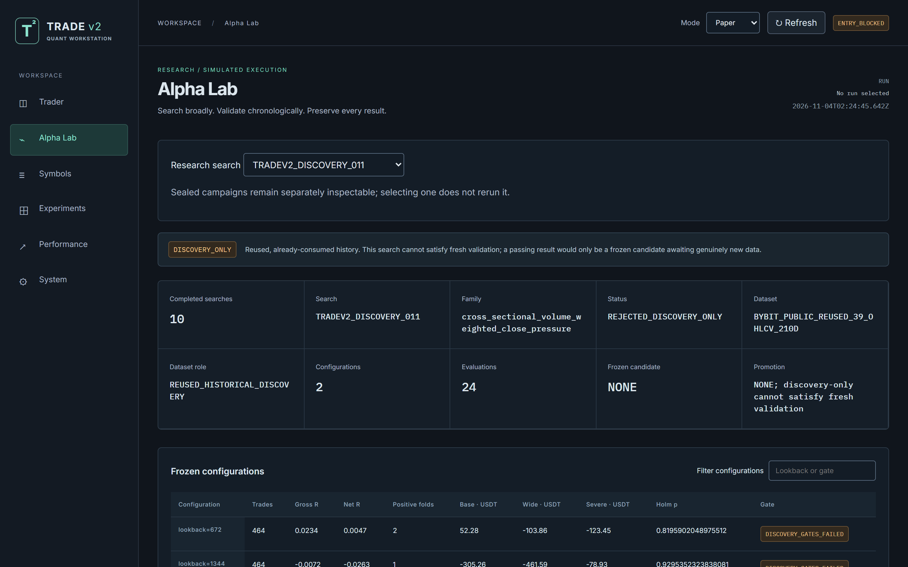
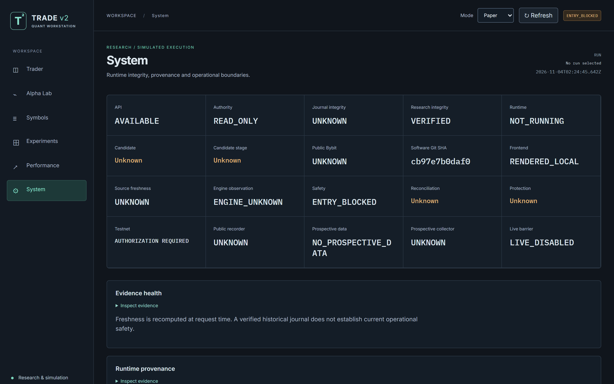
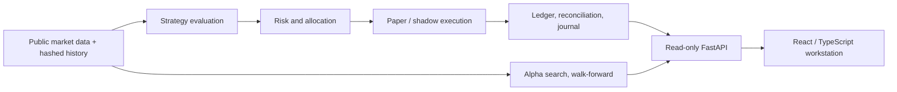

# Trade v2

[](https://github.com/brkozer/trade-v2/actions/workflows/ci.yml)


Research-first quantitative trading platform: cost-aware alpha research, public-data
paper/shadow simulation, an append-only evidence ledger and a read-only operator
workstation (FastAPI + React/TypeScript). It is **not live-trading software**:
`LIVE_DISABLED` is enforced in code, and paper/shadow runtimes cannot construct an
authenticated exchange transport.

> **Disclaimer: not investment advice.** This repository is a personal software and
> research project shared for educational purposes only. Nothing here is financial,
> investment or trading advice, or a recommendation to buy or sell any asset. No strategy
> in this repository has been shown to be profitable; every researched strategy family
> was **rejected**. Trading crypto derivatives carries a high risk of losing money. Do your
> own research, and use this code entirely at your own risk; the author accepts no
> liability for any loss.



<details>
<summary>System page: read-only authority, verified research seals and the live barrier</summary>



</details>

## What this project demonstrates

- **Typed, modular backend**: Python 3.11, strict mypy, Pydantic models, separate
  strategy, risk, execution, accounting, reconciliation and research packages
  (`src/tradev2/`); Decimal for every money, price, fee and funding calculation.
- **Safety by construction**: the exchange client exposes a GET-only allowlist of
  public endpoints with no signer or order methods; unknown or unapproved strategies
  fail closed; missing data stays *unknown*, never zero.
- **Reproducible research**: preregistered searches, frozen manifests, nested
  walk-forward selection, hashed datasets and one-shot holdouts that refuse to be rerun.
- **Evidence and recovery**: SQLite WAL journal with chained digests, idempotent events,
  ordered migrations, online backup with integrity checks, resumable runs.
- **Operator UI**: React 18 + TypeScript workstation over a read-only FastAPI API that
  labels stale or historical evidence explicitly.
- **Quality gates**: pytest, Vitest + Testing Library,
  Ruff, mypy `--strict`, artifact checks and GitHub Actions CI on every push.



## Research outcome

The honest result is negative, and the platform is built to make that visible. Across
the initial six-family and final 14-family historical campaigns, all 20 family paths were
rejected; none earned prospective promotion. The final search recorded 28 configurations,
112 inner trials and 336 replays with nested chronological selection. See the
[final report](research/results/FINAL_ALPHA_SEARCH.md), its
[completion record](research/manifests/final_search_completion_003.json) and the
[initial report](research/results/INITIAL_ALPHA_CAMPAIGN.md).
[Search 004](research/results/ALPHA_SEARCH_004.md) added 20 symbols of newly acquired
public history, 12 configurations and 108 chronological evaluations: **zero promotions**.
Negative evidence is a product outcome, not permission to trade a historical winner.

Five further discovery-only searches (005 funding carry, 006 UTC-hour seasonality,
007 low idiosyncratic volatility, 008 low-volume dislocation reversal, 009 idiosyncratic
MAX) reused consumed history and were all **rejected**; none froze a candidate. Through
009 the [research ledger](research/RESEARCH_LEDGER.md) counts 68 searched configurations
and 726 replay evaluations, with zero promotions. Reports:
[005](research/results/DISCOVERY_SEARCH_005.md), [006](research/results/DISCOVERY_SEARCH_006.md),
[007](research/results/DISCOVERY_SEARCH_007.md), [008](research/results/DISCOVERY_SEARCH_008.md),
[009](research/results/DISCOVERY_SEARCH_009.md).

**There is no profitable strategy in this repository.** Every tested mechanism lost
money after realistic costs on historical data. The only path to a candidate is new,
independently dated prospective evidence: at least 28 forward days of public data,
then a new preregistered search. `inspect-prospective` reports how far that gate is.

## Local setup

From this directory, use Python 3.11+ and Node 20+:

```powershell
py -3.11 -m venv .venv
.\.venv\Scripts\python.exe -m pip install -e '.[dev]'
cd frontend
npm ci
npm run build
npm test
cd ..
.\.venv\Scripts\python.exe -m pytest -q
.\.venv\Scripts\python.exe -m ruff check .
.\.venv\Scripts\python.exe -m mypy src/tradev2
```

All virtual environments, npm caches, journals and downloaded public datasets belong
under this target repository and are ignored by Git.

## Operator commands

Start the whole local workstation in one PowerShell command (dependencies installed
as above):

```powershell
.\scripts\start_trade_v2.ps1
.\scripts\status_trade_v2.ps1
```

Open `http://127.0.0.1:5173/` for the six-page workstation or
`http://127.0.0.1:8000/docs` for the read-only API. Add `-OpenBrowser` to the
start command to open the UI automatically. When finished:

```powershell
.\scripts\stop_trade_v2.ps1
```

Start and stop are idempotent; the launcher records process identities in ignored
`runtime/operator/` and stops only its own API and UI processes. This does not
start a trading simulation or connect an account. The UI distinguishes a stopped
last run from a current account and shows sealed historical research while idle.

Run finite public-data simulations and inspect their evidence separately:

```powershell
.\.venv\Scripts\python.exe -m tradev2.cli inspect-candidates --search final
.\.venv\Scripts\python.exe -m tradev2.cli inspect-candidates --search 004
.\.venv\Scripts\python.exe -m tradev2.cli inspect-candidates --search 009
.\.venv\Scripts\python.exe -m tradev2.cli inspect-prospective
.\.venv\Scripts\python.exe -m tradev2.cli replay-parity
.\.venv\Scripts\python.exe -m tradev2.cli run --config configs/paper.json --cycles 1
.\.venv\Scripts\python.exe -m tradev2.cli run --config configs/shadow.json --cycles 1
.\.venv\Scripts\python.exe -m tradev2.cli run --config configs/factor_fixture.paper.json --cycles 1
.\.venv\Scripts\python.exe -m tradev2.cli run --config configs/factor_fixture.shadow.json --cycles 1
.\.venv\Scripts\python.exe -m tradev2.cli record-public --symbols BTCUSDT ETHUSDT --seconds 30
.\.venv\Scripts\python.exe -m tradev2.cli testnet-preflight
.\.venv\Scripts\python.exe -m tradev2.cli inspect-runtime --mode paper
```

The non-RSI factor configs are explicitly labeled `TEST_FIXTURE`; their historical
result was **rejected**, so they demonstrate architecture, not alpha approval.
Without fixture mode, a registered factor must have a sealed promotion and be
approved for the requested paper or shadow stage. Unknown/rejected/unapproved
candidates fail closed. `REFERENCE_CANDIDATE_001` is also a regression fixture.
The API is loopback and read-only; do not expose it publicly. `paper.json` selects
simulated paper operation. Simulations can be resumed with `--resume <run-id>`.
Stop a running finite simulation with `stop-runtime --mode paper --run-id <id>`.
`record-public` captures prospective public observations without trading authority;
use `analyze-microstructure --run-id <id>` for paired smoke research. The final
historical `research --search final` command is intentionally one-shot and now refuses
a repeat because its preregistered evidence was consumed. A new search needs a new
identity, frozen manifest, independently dated data and explicit accounting for
earlier attempts; do not change the consumed final manifest or rerun it under a new
name. The historical command is `python -m tradev2.cli research --search final`
only for an unconsumed checkout; here, inspect its sealed result instead.
The CLI records events and checkpoints in ignored `runtime/`; it does not place orders.

## Evidence and design

Start with [architecture](docs/ARCHITECTURE.md), [safety](docs/SAFETY_MODEL.md),
[execution model](docs/EXECUTION_MODEL.md), [research protocol](docs/RESEARCH_PROTOCOL.md),
and [operations](docs/OPERATIONS.md). [Source manifest](docs/migration/SOURCE_MANIFEST.md)
records the exact read-only revisions; [migration map](docs/migration/SOURCE_TO_TARGET_MAP.md)
states what was adapted or rejected. [Live acceptance](docs/LIVE_ACCEPTANCE.md)
describes unmet gates, not a request to enable live trading. [Completion audit](docs/FINAL_COMPLETION_AUDIT.md)
distinguishes implemented software from scientific and external acceptance.
Bounded research-cycle reports are in [research/cycles](research/cycles/).
