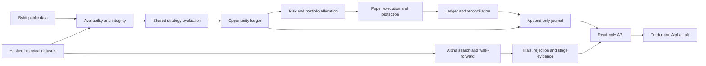

# Architecture

Trade v2 is a typed Python 3.11+ modular application with a local, read-only FastAPI
control plane and a React/TypeScript workstation. SQLite WAL stores runtime evidence;
immutable JSON manifests identify research, software, data and assumptions. NumPy arrays
serve historical feature computation; canonical financial arithmetic uses Decimal.

Strategy, risk, exchange rules, execution, accounting, research selection and UI are
separate responsibilities. Runtime strategies are deterministic local functions, with
no LLM/cloud model dependency. The research engine shares reference strategy parameters
and semantics with runtime evaluation. Replay prices occur after signal availability.

## Capability boundary

PublicBybit exposes a GET-only allowlist of built-in public endpoints. It has no credentials,
signer, private endpoints, order, cancel or position mutation methods. Simulation runtimes
receive this public client and a simulator only. Live is disabled at the runtime boundary.
The simulation runtime refuses testnet mode; the separate signed testnet transport is
host-pinned, import-isolated from simulation and requires dedicated config, environment
and startup-proof authorization (see the safety model).

## Evidence and recovery

Immutable run manifests carry Git SHA/dirty state, normalized config/hash, parameter hash,
universe/hash, versions, economics provenance and data identity. Journal events use unique
IDs and a chained digest; duplicate identical events are idempotent and conflicting IDs
are rejected. Verification also requires the immutability triggers, checks that indexed
columns match each hashed body, anchors the chain tail to SQLite's sequence counter, and
checks the chained hashes that bind each run manifest and checkpoint to its row.
Resume uses only the newest chain-bound checkpoint and refuses when any evidence other
than the terminal runtime record follows it. This is local integrity detection, not an
externally notarized audit trail.
SQLite migrations are ordered and transactional. Backup uses SQLite's online backup API,
refuses pending transactions, checks integrity and returns a checksum. Restore refuses
overwriting an existing destination. Readers use `mode=ro`, never `immutable=1`.

The operator UI reads typed API responses, never SQLite directly. Missing/stale evidence
remains unknown; historical results cannot make current runtime health safe. Research
results are labelled by stage and historical reuse status.

## Growth boundaries

One local runtime owns each simulation/account profile in this installation. Local file
locks do not provide cross-host coordination. Distributed authority, calibrated queue
execution and authenticated testnet lifecycle are separate future milestones. ML selection
and microstructure alpha require suitable data; no unused model scaffolding is shipped.
